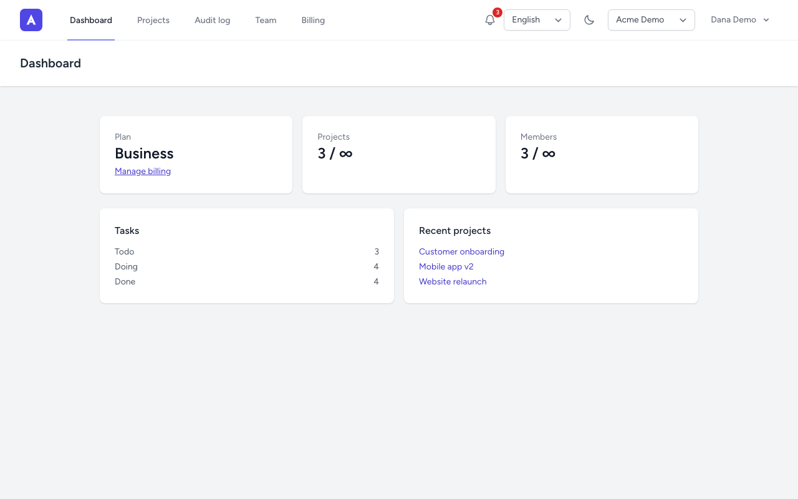
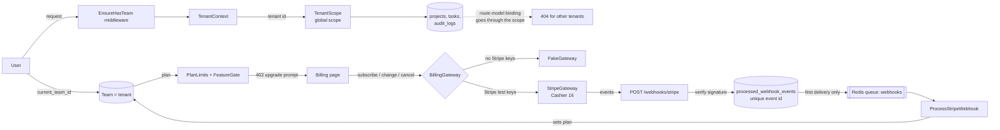

# Acme SaaS Starter (Laravel)

A multi-tenant SaaS starter built on Laravel 12, Inertia, Vue 3 and TypeScript.
Teams, roles, signed invitations, plan limits, feature flags and an audit log work out of the box.
It runs locally with **zero paid keys**: billing uses a fake gateway unless you add Stripe test keys.

[](https://github.com/kevinmakwana/saas-starter-laravel/actions/workflows/ci.yml)



## Quick start

Requires Docker (and `make`). One command starts the app, MySQL 8, Redis, Mailpit, a Horizon queue worker and the scheduler, then migrates and seeds:

```bash
make up
```

| What | Where |
| --- | --- |
| App | <http://localhost:8080> |
| Mailpit (all outgoing mail) | <http://localhost:8025> |
| Horizon (queues, locally open to everyone) | <http://localhost:8080/horizon> |

**Demo login:** `demo@acme.test` / `password` (owner of the *Acme Demo* team on the Business plan).
Also seeded with the same password: `admin@acme.test` (Admin) and `member@acme.test` (Member).

Host ports are configurable in `.env` (`APP_PORT`, `FORWARD_DB_PORT`, `FORWARD_REDIS_PORT`,
`FORWARD_MAILPIT_PORT`, `FORWARD_MAILPIT_DASHBOARD_PORT`, `VITE_PORT`) in case the defaults are busy.
All ports bind to `127.0.0.1` only. If you change `DB_DATABASE` or `DB_USERNAME` after the first start, run `./vendor/bin/sail down -v` first so MySQL re-initialises. Other commands: `make dev` (Vite HMR), `make test`, `make fresh`, `make logs`, `make down`.

### Without Docker

Only PHP 8.4, Composer and Node 22 are needed. This skips MySQL, Redis, Mailpit, Horizon and the scheduler, which is fine for a look around:

```bash
cp .env.example .env
composer install && npm ci && npm run build
php artisan key:generate
touch database/database.sqlite
```

In `.env`, delete the `DB_HOST`, `DB_PORT`, `DB_DATABASE`, `DB_USERNAME` and `DB_PASSWORD` lines (SQLite would otherwise read `DB_DATABASE` as a file name) and set
`DB_CONNECTION=sqlite`, `QUEUE_CONNECTION=sync`, `SESSION_DRIVER=file`, `CACHE_STORE=file` and `MAIL_MAILER=log`. Then:

```bash
php artisan migrate --seed
php artisan serve      # http://127.0.0.1:8000, same demo logins as above
```

Mail is written to `storage/logs/laravel.log` instead of Mailpit, so an invitation or email-change link has to be copied from there. `php artisan test` needs none of this: it runs on in-memory SQLite out of the box.

## How it fits together



**Tenancy.** One database; tenant-owned tables carry `tenant_id`. The `BelongsToTenant` trait adds a global
scope and refuses writes for any other tenant. The current tenant is the user's current team, and membership
is re-checked, so removing someone from a team cuts access immediately. With no tenant the scope matches nothing.
Route model binding goes through the same scope, so another tenant's record is a plain 404.

## Features

- **Auth and teams:** register, log in, create teams, switch teams (Breeze, Inertia, Vue 3, TypeScript, Tailwind).
- **Roles and policies:** Owner, Admin and Member. Owners manage roles, billing and ownership transfer. Admins invite members and see the audit log.
- **Invitations:** signed, expiring links (7 days), bound to the invited email, single use. Owners and admins can resend one from the Team page (a fresh 7 days, also after it expired, as long as the plan has a seat). Emails are queued on Redis and show up in Mailpit.
- **Billing:** Free, Pro and Business plans (limits and prices in `config/billing.php`). Subscribe, change plan, cancel and resume.
  `FakeGateway` by default, `StripeGateway` (Cashier 16) when `BILLING_GATEWAY=stripe` and Stripe test keys are set.
- **Trials and yearly billing:** a team's first paid subscription gets a 14-day free trial (`BILLING_TRIAL_DAYS`, `0` turns it off).
  Stripe Checkout still collects a card; it is charged when the trial ends unless the owner cancels first, and `customer.subscription.trial_will_end`
  emails the owner three days before. A team that has had any subscription before does not get another trial. Plans can also be billed
  yearly (10x the monthly price, `yearly_price` in `config/billing.php`): the yearly Stripe price is `STRIPE_PRICE_*_YEARLY`, and a plan
  without one is monthly only. The fake gateway has neither; there is no per-seat billing.
- **Webhooks:** `POST /webhooks/stripe` verifies the signature, stores each event id once (idempotent) and processes it on the `webhooks` queue.
  It is the only Stripe endpoint (Cashier's own `/stripe/webhook` route is switched off). Send it `customer.subscription.created`,
  `.updated` and `.deleted`, `customer.subscription.trial_will_end`, `invoice.payment_failed` and `invoice.paid`. Cashier's subscription records are kept in step from
  the same job, an event older than one already applied is ignored (Stripe does not guarantee order), and a subscription whose
  first payment is still `incomplete` does not get the plan yet.
- **Failed payments:** `invoice.payment_failed` starts a 7-day grace period (`billing.grace_days`) and emails the owner once.
  The paid plan stays active during grace, drops to Free if it is not fixed, and is restored by `invoice.paid`. A banner warns the team.
- **Webhook recovery:** an event that was stored but never processed is retried when Stripe redelivers it, and every 5 minutes by the
  scheduler (`webhooks:retry-stuck`, events from the last 7 days). `php artisan webhooks:replay evt_123` reprocesses one event on demand.
  Failed jobs are logged with the stored record id.
- **Rate limiting:** named limiters on registration, password reset, team creation, invitations, billing actions, the data export, the 2FA code step and the webhook
  (login and email verification are throttled by Breeze), email-address changes and the exports. Throttled pages show a banner with the retry time. Limits live in `config/throttle.php`.
- **Plan limits:** project and member limits enforced in policies, with a friendly upgrade prompt.
  A team that drops to a smaller plan while over its limits (for example after a cancelled subscription) loses nothing: every
  project and member stays, and can still be read, edited and deleted. Only adding more is blocked, a banner tells every member
  why, and a pending invitation cannot be accepted until the team has a free seat again.
- **Customer Portal and invoices:** with Stripe, owners get an "Update payment method" link to Stripe's Customer Portal (the failed
  payment email links straight to it) and an invoice list on the billing page, loaded after the page so a slow Stripe call never
  blocks it. Only the owner sees amounts.
- **Feature flags:** `FeatureGate` and a `feature:` route middleware. For example `audit_log` is Business only.
- **Projects and tasks:** CRUD with search, status filter and pagination. Pro and Business can export a project's tasks as CSV
  (spreadsheet formulas in titles are neutralised).
- **Account deletion:** an owner whose team still has other members must transfer ownership first. Teams the user owns alone are
  deleted with the account, and their Stripe subscription is cancelled immediately.
- **Team deletion:** the owner can delete a team from the Team page, after typing its name and their password. Billing is ended first, so if
  Stripe fails nothing is deleted. Projects, tasks, invitations and the audit log go with the team (so the deletion itself is not in the log),
  the other members get an email, and everyone lands on another team of theirs or on "create a team".
- **Task attachments:** any member can attach files to a task (project page, "Files" on each task) and download or remove them. Files are stored on a private disk under `attachments/{team id}/{random id}`, never under the name the user typed, and are only served through an authorized request, always as a download. Types are an allowlist (images, PDF, text, CSV, Markdown, Office documents) checked by file name **and** by what the file actually contains, so a page renamed to `photo.png` is refused; SVG and HTML are not allowed. Each plan has a total storage quota (Free 25 MB, Pro 1 GB, Business unlimited, `billing.plans.*.limits.storage_mb`) and every file is capped at 10 MB (`ATTACHMENTS_MAX_FILE_KB`); going over shows the usual upgrade prompt, and a downgrade never deletes files. Files are removed with their task, project, team or account; they stay when the member who added them leaves, and the data download lists the names and sizes of what you uploaded. `ATTACHMENTS_DISK` points at any Laravel disk: for S3, `composer require league/flysystem-aws-s3-v3` and define an `s3` disk. There is no virus scanning and no image resizing.
- **In-app notifications:** a bell in the header with an unread badge and the latest ten, refreshed quietly every minute while the tab is in view. Owners and admins hear when someone joins; owners when the plan changes, a payment fails or a trial is about to end; members when they are removed or their team is deleted. Opening one marks it read, switches to its team if needed and goes to the right page (the target is always an internal path). They are stored with Laravel's database channel as a kind plus values, not text, so the wording lives in one place (`resources/js/lib/notificationText.ts`). The emails the app already sends are unchanged. Old ones are deleted after 60 days (`RETENTION_NOTIFICATIONS_DAYS`, `0` keeps them), they go with the account, and they are part of the data download. Only the newest ten are shown; there is no full history page.
- **Dark mode:** a sun/moon toggle in the header (and on the sign-in pages). It follows the system setting until you choose, and the choice is remembered in the browser. A small inline script in the page head (allowed by the CSP nonce) applies it before first paint, so there is no flash. Every page has dark styles, form controls follow the theme from one place in `resources/css/app.css`, and an automated contrast scan (axe, WCAG AA) covers the main pages in both themes.
- **Two-factor authentication:** optional per user, on every plan (`Profile → Two-factor authentication`). Setup shows a QR code and a key,
  and only a correct first code turns it on, then 8 single-use recovery codes are shown once. After the right password, a user with 2FA is
  not signed in yet: they get a code (or recovery code) prompt, limited to 5 tries a minute per account, and a pending sign-in expires after
  10 minutes. A code works once (the last accepted time step is stored). Turning it on or off and making new recovery codes ask for the password
  again. The secret and the codes are encrypted at rest and never sent to the browser after setup. A password reset does **not** turn 2FA off.
  Built on `pragmarx/google2fa` and `bacon/bacon-qr-code`. Not included: requiring it for a team, SMS or email codes, passkeys, trusted devices,
  and an admin reset, so a user who lost both the app and the recovery codes has to be reset by hand (clear the four `two_factor_*` columns).
- **Data export:** `Profile → Download your data` gives users one JSON file with their account, team memberships and roles, the invitations
  they sent or hold, and the audit entries they caused (across all their teams). It needs the current password, is limited to 3 per hour
  per user (wrong passwords count), and is recorded in the audit log without any of the data. Team content (projects, tasks) and billing
  belong to the team and are not included, and neither are password hashes, tokens or other people's accounts. The file is built on the
  request and streamed, with no job or stored file, which is fine while the app keeps no large per-user content.
- **Email change:** a new address needs the current password and does not replace the old one until its owner opens a signed link
  (60 minutes) mailed to it, while signed in. Opening it verifies the address. The old address gets a notice when the change is
  requested and again when it is done. Requesting a change is limited to 5 per hour; the name can still be saved freely. Other sessions
  are not signed out when the address changes.
- **Security headers:** a strict Content-Security-Policy (per-request nonce, no inline or eval scripts), HSTS over https,
  `X-Frame-Options`, `X-Content-Type-Options`, `Referrer-Policy` and `Permissions-Policy`. Configure in `config/security.php`.
- **Observability:** every response has an `X-Request-Id`; logs and Sentry errors carry the request, user and team ids (never
  names or emails). Production logs are JSON on stderr (`LOG_STACK=json`), unhandled exceptions go to Sentry when
  `SENTRY_LARAVEL_DSN` is set, a failed queued job emails `ALERT_EMAIL` (throttled), and Horizon shows the Redis queues at `/horizon`
  (local: open; elsewhere only `HORIZON_ALLOWED_EMAILS`).
- **Housekeeping:** the scheduler runs `model:prune` daily: expired invitations, processed webhook events and, if you set a
  retention, old audit log entries are deleted (`config/retention.php`, `RETENTION_*` in `.env`).
- **Audit log:** team-scoped "who did what", visible to Owners and Admins on Business, with a CSV export (rate limited, formula-safe). It records team activity plus sign-ins, profile and password changes, and team creation and renames. Those user events are written to the user's current team, so a user with no team leaves no entry, and failed logins are not logged. Entries are append-only for application code: the model refuses updates and deletes. Only retention pruning and deleting the team remove rows, and a database-level guard is not included.

### Using real Stripe test keys (optional)

```dotenv
BILLING_GATEWAY=stripe
STRIPE_KEY=pk_test_...
STRIPE_SECRET=sk_test_...
STRIPE_WEBHOOK_SECRET=whsec_...
STRIPE_PRICE_PRO=price_...
STRIPE_PRICE_BUSINESS=price_...
# Optional, for yearly billing (create a yearly recurring price on each product)
STRIPE_PRICE_PRO_YEARLY=price_...
STRIPE_PRICE_BUSINESS_YEARLY=price_...
```

Forward events with `stripe listen --forward-to localhost:8080/webhooks/stripe`.

Subscribing twice is refused (change plan, resume or the portal instead), and a Stripe error shows a message to the owner and
changes nothing locally. When a plan change leaves a team over its limits the owner gets an email; nothing is deleted or locked.

For the Customer Portal, save a portal configuration once in the Stripe Dashboard (Settings, Billing, Customer portal; in test mode
too), otherwise Stripe refuses to create portal sessions and the owner sees a "could not open the billing portal" message.

`StripeGateway` and Cashier are tested against [stripe-mock](https://github.com/stripe/stripe-mock), Stripe's official mock server,
in CI. The Stripe path has not been exercised against live Stripe in this repo; the fake gateway, the webhook pipeline and
the mocked Stripe API are covered by tests.

## Testing and quality

```bash
make test                  # Pest feature + unit tests (inside Sail)
# The StripeGateway tests are skipped unless stripe-mock is running:
#   docker run --rm -p 12111:12111 stripe/stripe-mock
#   STRIPE_MOCK_URL=http://127.0.0.1:12111 vendor/bin/pest --group=stripe-mock
npm run e2e                # Playwright browser tests against the running app (make up first)
vendor/bin/pint --test     # code style
vendor/bin/phpstan analyse # Larastan, level 8
npm run build              # vue-tsc type check + Vite build
```

Tests cover tenancy isolation (reads, writes, route model binding), role policies, the invitation flow, plan limits,
webhook signature and idempotency, payment failures, rate limits, feature gates, and the seeder.
Browser tests (Playwright) cover login, registration with email verification through Mailpit, tenant isolation, the Free plan
limit and upgrade, and the invitation flow with its signed link. CI (GitHub Actions) runs Pint, Larastan and Pest against a
MySQL 8.4 service container, plus the Playwright suite in a second job, on every push and pull request.

For repeated local E2E runs from one IP, set `THROTTLE_REGISTRATION_PER_HOUR=1000` in `.env`.

## Deploying

The [Dockerfile](Dockerfile) builds one production image that runs the web, worker (Horizon) and scheduler roles. CI builds and
smoke-tests it; pushing a `v*` tag publishes it to GitHub Container Registry. [docs/deploy.md](docs/deploy.md) covers the
configuration, the release steps, migration safety, backups and where to look during an incident.

## What I'd do next in production

- Run a nightly job against Stripe's real test mode (stripe-mock returns canned fixtures, so it cannot prove your real prices and portal settings).
- Extend dunning: reminder emails during the grace period (today the owner gets one email when the payment fails).
- Move large tenants to per-tenant database or schema isolation if needed, and add DB-level row security as a second line of defence.
- Add SSO for Business.
- Ship the logs somewhere searchable and add uptime and queue-depth monitoring on top of the Sentry and Horizon alerts.
- Add seat-based billing and proration instead of fixed per-plan limits (trials and yearly billing are done).
- Zero-downtime deploys with migration safety checks.

## License

[MIT](LICENSE) © Kevin Makwana. "Acme" is a fictional brand used for demonstration.
