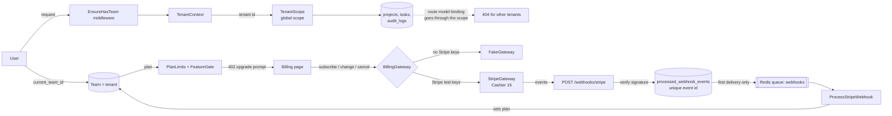

# Acme SaaS Starter (Laravel)

A multi-tenant SaaS starter built on Laravel 12, Inertia, Vue 3 and TypeScript.
Teams, roles, signed invitations, plan limits, feature flags and an audit log work out of the box.
It runs locally with **zero paid keys**: billing uses a fake gateway unless you add Stripe test keys.

[](https://github.com/kevinmakwana/saas-starter-laravel/actions/workflows/ci.yml)


## Quick start

Requires Docker (and `make`). One command starts the app, MySQL 8, Redis, Mailpit, a Horizon queue worker and the scheduler, then migrates and seeds:

```bash
make up
```

| What | Where |
| --- | --- |
| App | <http://localhost:8080> |
| Mailpit (all outgoing mail) | <http://localhost:8025> |
| Horizon (queues, locally open to everyone) | <http://localhost:8080/horizon> |

**Demo login:** `demo@acme.test` / `password` (owner of the *Acme Demo* team on the Business plan).
Also seeded with the same password: `admin@acme.test` (Admin) and `member@acme.test` (Member).

Host ports are configurable in `.env` (`APP_PORT`, `FORWARD_DB_PORT`, `FORWARD_REDIS_PORT`,
`FORWARD_MAILPIT_PORT`, `FORWARD_MAILPIT_DASHBOARD_PORT`, `VITE_PORT`) in case the defaults are busy.
All ports bind to `127.0.0.1` only. If you change `DB_DATABASE` or `DB_USERNAME` after the first start, run `./vendor/bin/sail down -v` first so MySQL re-initialises. Other commands: `make dev` (Vite HMR), `make test`, `make fresh`, `make logs`, `make down`.

## How it fits together



**Tenancy.** One database; tenant-owned tables carry `tenant_id`. The `BelongsToTenant` trait adds a global
scope and refuses writes for any other tenant. The current tenant is the user's current team, and membership
is re-checked, so removing someone from a team cuts access immediately. With no tenant the scope matches nothing.
Route model binding goes through the same scope, so another tenant's record is a plain 404.

## Features

- **Auth and teams:** register, log in, create teams, switch teams (Breeze, Inertia, Vue 3, TypeScript, Tailwind).
- **Roles and policies:** Owner, Admin and Member. Owners manage roles, billing and ownership transfer. Admins invite members and see the audit log.
- **Invitations:** signed, expiring links (7 days), bound to the invited email, single use. Emails are queued on Redis and show up in Mailpit.
- **Billing:** Free, Pro and Business plans (limits and prices in `config/billing.php`). Subscribe, change plan, cancel and resume.
  `FakeGateway` by default, `StripeGateway` (Cashier 16) when `BILLING_GATEWAY=stripe` and Stripe test keys are set.
- **Webhooks:** `POST /webhooks/stripe` verifies the signature, stores each event id once (idempotent) and processes it on the `webhooks` queue.
- **Failed payments:** `invoice.payment_failed` starts a 7-day grace period (`billing.grace_days`) and emails the owner once.
  The paid plan stays active during grace, drops to Free if it is not fixed, and is restored by `invoice.paid`. A banner warns the team.
- **Webhook recovery:** an event that was stored but never processed is retried when Stripe redelivers it, and every 5 minutes by the
  scheduler (`webhooks:retry-stuck`, events from the last 7 days). `php artisan webhooks:replay evt_123` reprocesses one event on demand.
  Failed jobs are logged with the stored record id.
- **Rate limiting:** named limiters on registration, password reset, team creation, invitations, billing actions and the webhook
  (login and email verification are throttled by Breeze). Throttled pages show a banner with the retry time. Limits live in `config/throttle.php`.
- **Plan limits:** project and member limits enforced in policies, with a friendly upgrade prompt.
  A team that drops to a smaller plan while over its limits (for example after a cancelled subscription) loses nothing: every
  project and member stays, and can still be read, edited and deleted. Only adding more is blocked, a banner tells every member
  why, and a pending invitation cannot be accepted until the team has a free seat again.
- **Customer Portal and invoices:** with Stripe, owners get an "Update payment method" link to Stripe's Customer Portal (the failed
  payment email links straight to it) and an invoice list on the billing page, loaded after the page so a slow Stripe call never
  blocks it. Only the owner sees amounts.
- **Feature flags:** `FeatureGate` and a `feature:` route middleware. For example `audit_log` is Business only.
- **Projects and tasks:** CRUD with search, status filter and pagination. Pro and Business can export a project's tasks as CSV
  (spreadsheet formulas in titles are neutralised).
- **Account deletion:** an owner whose team still has other members must transfer ownership first. Teams the user owns alone are
  deleted with the account, and their Stripe subscription is cancelled immediately.
- **Security headers:** a strict Content-Security-Policy (per-request nonce, no inline or eval scripts), HSTS over https,
  `X-Frame-Options`, `X-Content-Type-Options`, `Referrer-Policy` and `Permissions-Policy`. Configure in `config/security.php`.
- **Observability:** every response has an `X-Request-Id`; logs and Sentry errors carry the request, user and team ids (never
  names or emails). Production logs are JSON on stderr (`LOG_STACK=json`), unhandled exceptions go to Sentry when
  `SENTRY_LARAVEL_DSN` is set, a failed queued job emails `ALERT_EMAIL` (throttled), and Horizon shows the Redis queues at `/horizon`
  (local: open; elsewhere only `HORIZON_ALLOWED_EMAILS`).
- **Housekeeping:** the scheduler runs `model:prune` daily: expired invitations, processed webhook events and, if you set a
  retention, old audit log entries are deleted (`config/retention.php`, `RETENTION_*` in `.env`).
- **Audit log:** team-scoped "who did what", visible to Owners and Admins on Business.

### Using real Stripe test keys (optional)

```dotenv
BILLING_GATEWAY=stripe
STRIPE_KEY=pk_test_...
STRIPE_SECRET=sk_test_...
STRIPE_WEBHOOK_SECRET=whsec_...
STRIPE_PRICE_PRO=price_...
STRIPE_PRICE_BUSINESS=price_...
```

Forward events with `stripe listen --forward-to localhost:8080/webhooks/stripe`.

For the Customer Portal, save a portal configuration once in the Stripe Dashboard (Settings, Billing, Customer portal; in test mode
too), otherwise Stripe refuses to create portal sessions and the owner sees a "could not open the billing portal" message.

`StripeGateway` and Cashier are tested against [stripe-mock](https://github.com/stripe/stripe-mock), Stripe's official mock server,
in CI. The Stripe path has not been exercised against live Stripe in this repo; the fake gateway, the webhook pipeline and
the mocked Stripe API are covered by tests.

## Testing and quality

```bash
make test                  # Pest feature + unit tests (inside Sail)
# The StripeGateway tests are skipped unless stripe-mock is running:
#   docker run --rm -p 12111:12111 stripe/stripe-mock
#   STRIPE_MOCK_URL=http://127.0.0.1:12111 vendor/bin/pest --group=stripe-mock
npm run e2e                # Playwright browser tests against the running app (make up first)
vendor/bin/pint --test     # code style
vendor/bin/phpstan analyse # Larastan, level 6
npm run build              # vue-tsc type check + Vite build
```

Tests cover tenancy isolation (reads, writes, route model binding), role policies, the invitation flow, plan limits,
webhook signature and idempotency, payment failures, rate limits, feature gates, and the seeder.
Browser tests (Playwright) cover login, registration with email verification through Mailpit, tenant isolation, the Free plan
limit and upgrade, and the invitation flow with its signed link. CI (GitHub Actions) runs Pint, Larastan and Pest against a
MySQL 8.4 service container, plus the Playwright suite in a second job, on every push and pull request.

For repeated local E2E runs from one IP, set `THROTTLE_REGISTRATION_PER_HOUR=1000` in `.env`.

## Deploying

The [Dockerfile](Dockerfile) builds one production image that runs the web, worker (Horizon) and scheduler roles. CI builds and
smoke-tests it; pushing a `v*` tag publishes it to GitHub Container Registry. [docs/deploy.md](docs/deploy.md) covers the
configuration, the release steps, migration safety, backups and where to look during an incident.

## What I'd do next in production

- Run a nightly job against Stripe's real test mode (stripe-mock returns canned fixtures, so it cannot prove your real prices and portal settings).
- Extend dunning: reminder emails during the grace period, and an email to the owner when a downgrade leaves the team over its limits.
- Move large tenants to per-tenant database or schema isolation if needed, and add DB-level row security as a second line of defence.
- Add 2FA and SSO for Business.
- Make audit logs append-only and exportable, with retention rules.
- Ship the logs somewhere searchable and add uptime and queue-depth monitoring on top of the Sentry and Horizon alerts.
- Add seat-based billing and proration instead of fixed per-plan limits.
- Zero-downtime deploys with migration safety checks.

## License

[MIT](LICENSE) © Kevin Makwana. "Acme" is a fictional brand used for demonstration.
