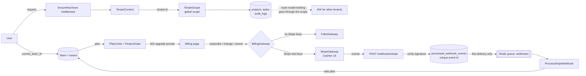

# Acme SaaS Starter (Laravel)

A multi-tenant SaaS starter built on Laravel 12, Inertia, Vue 3 and TypeScript.
Teams, roles, signed invitations, plan limits, feature flags and an audit log work out of the box.
It runs locally with **zero paid keys**: billing uses a fake gateway unless you add Stripe test keys.

[](https://github.com/kevinmakwana/saas-starter-laravel/actions/workflows/ci.yml)


## Quick start

Requires Docker (and `make`). One command starts the app, MySQL 8, Redis, Mailpit and a queue worker, then migrates and seeds:

```bash
make up
```

| What | Where |
| --- | --- |
| App | <http://localhost:8080> |
| Mailpit (all outgoing mail) | <http://localhost:8025> |

**Demo login:** `demo@acme.test` / `password` (owner of the *Acme Demo* team on the Business plan).
Also seeded with the same password: `admin@acme.test` (Admin) and `member@acme.test` (Member).

Host ports are configurable in `.env` (`APP_PORT`, `FORWARD_DB_PORT`, `FORWARD_REDIS_PORT`,
`FORWARD_MAILPIT_PORT`, `FORWARD_MAILPIT_DASHBOARD_PORT`, `VITE_PORT`) in case the defaults are busy.
All ports bind to `127.0.0.1` only. If you change `DB_DATABASE` or `DB_USERNAME` after the first start, run `./vendor/bin/sail down -v` first so MySQL re-initialises. Other commands: `make dev` (Vite HMR), `make test`, `make fresh`, `make logs`, `make down`.

## How it fits together



**Tenancy.** One database; tenant-owned tables carry `tenant_id`. The `BelongsToTenant` trait adds a global
scope and refuses writes for any other tenant. The current tenant is the user's current team, and membership
is re-checked, so removing someone from a team cuts access immediately. With no tenant the scope matches nothing.
Route model binding goes through the same scope, so another tenant's record is a plain 404.

## Features

- **Auth and teams:** register, log in, create teams, switch teams (Breeze, Inertia, Vue 3, TypeScript, Tailwind).
- **Roles and policies:** Owner, Admin and Member. Owners manage roles, billing and ownership transfer. Admins invite members and see the audit log.
- **Invitations:** signed, expiring links (7 days), bound to the invited email, single use. Emails are queued on Redis and show up in Mailpit.
- **Billing:** Free, Pro and Business plans (limits and prices in `config/billing.php`). Subscribe, change plan, cancel and resume.
  `FakeGateway` by default, `StripeGateway` (Cashier 16) when `BILLING_GATEWAY=stripe` and Stripe test keys are set.
- **Webhooks:** `POST /webhooks/stripe` verifies the signature, stores each event id once (idempotent) and processes it on the `webhooks` queue.
- **Failed payments:** `invoice.payment_failed` starts a 7-day grace period (`billing.grace_days`) and emails the owner once.
  The paid plan stays active during grace, drops to Free if it is not fixed, and is restored by `invoice.paid`. A banner warns the team.
- **Rate limiting:** named limiters on registration, password reset, team creation, invitations, billing actions and the webhook
  (login and email verification are throttled by Breeze). Throttled pages show a banner with the retry time. Limits live in `config/throttle.php`.
- **Plan limits:** project and member limits enforced in policies, with a friendly upgrade prompt.
- **Feature flags:** `FeatureGate` and a `feature:` route middleware. For example `audit_log` is Business only.
- **Projects and tasks:** CRUD with search, status filter and pagination.
- **Audit log:** team-scoped "who did what", visible to Owners and Admins on Business.

### Using real Stripe test keys (optional)

```dotenv
BILLING_GATEWAY=stripe
STRIPE_KEY=pk_test_...
STRIPE_SECRET=sk_test_...
STRIPE_WEBHOOK_SECRET=whsec_...
STRIPE_PRICE_PRO=price_...
STRIPE_PRICE_BUSINESS=price_...
```

Forward events with `stripe listen --forward-to localhost:8080/webhooks/stripe`.
The Stripe path has not been exercised against live Stripe in this repo (see below); the fake gateway and the webhook pipeline are covered by tests.

## Testing and quality

```bash
make test                  # Pest feature + unit tests (inside Sail)
npm run e2e                # Playwright browser tests against the running app (make up first)
vendor/bin/pint --test     # code style
vendor/bin/phpstan analyse # Larastan, level 6
npm run build              # vue-tsc type check + Vite build
```

Tests cover tenancy isolation (reads, writes, route model binding), role policies, the invitation flow, plan limits,
webhook signature and idempotency, payment failures, rate limits, feature gates, and the seeder.
Browser tests (Playwright) cover login, registration with email verification through Mailpit, tenant isolation, the Free plan
limit and upgrade, and the invitation flow with its signed link. CI (GitHub Actions) runs Pint, Larastan and Pest against a
MySQL 8.4 service container, plus the Playwright suite in a second job, on every push and pull request.

For repeated local E2E runs from one IP, set `THROTTLE_REGISTRATION_PER_HOUR=1000` in `.env`.

## What I'd do next in production

- Add Stripe Checkout and Customer Portal coverage and test the `StripeGateway` against Stripe's test mode in CI.
- Extend dunning: reminder emails during the grace period and a self-serve payment-method update (Customer Portal).
- Move large tenants to per-tenant database or schema isolation if needed, and add DB-level row security as a second line of defence.
- Add rate limiting on invitations and auth, 2FA, and SSO for Business.
- Make audit logs append-only and exportable, with retention rules.
- Observability: structured logs, Sentry, queue and failed-job alerts, Horizon for Redis queues.
- Add seat-based billing and proration instead of fixed per-plan limits.
- Zero-downtime deploys with migration safety checks.

## License

[MIT](LICENSE) © Kevin Makwana. "Acme" is a fictional brand used for demonstration.
